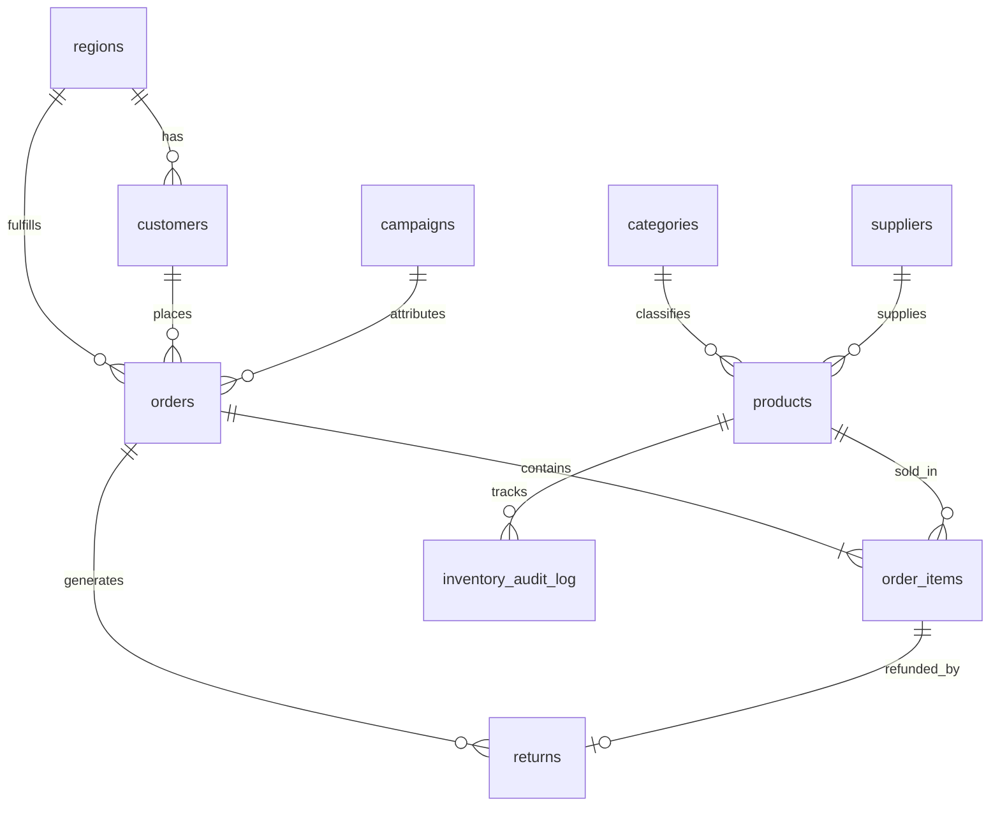

# RetailPulse — MySQL E-Commerce & Customer RFM Data Analysis

An end-to-end **MySQL 8.0+ Data Analysis portfolio project** modeling an omnichannel e-commerce business (**RetailPulse**) across **2024–2026**. It takes you from normalized database design and data quality auditing through 24 executive & advanced analytical queries (RFM segmentation, Cohort Retention, Pareto ABC, Market Basket Analysis) to reusable Views, Stored Procedures, and Triggers.

---

## Project Architecture & Execution Order

Run the SQL files strictly in numbered order:

| Order | File | Purpose |
| :---: | :--- | :--- |
| 1 | `01_schema.sql` | Creates the `retailpulse_dw` database, 10 normalized tables, constraints, and analytical indexes. |
| 2 | `02_seed_data.sql` | Loads realistic 2024–2026 sample data (5 regions, 6 categories, 6 suppliers, 24 products, 8 campaigns, 30 customers, 72 orders, 159 order items, 10 returns). |
| 3 | `03_data_cleaning_and_validation.sql` | Runs row-count inventory, null/duplicate checks, and chronological/financial business-rule audits. |
| 4 | `04_exploratory_and_kpi_analysis.sql` | Queries **Q1–Q12**: Executive KPIs, MoM & YoY trends, category margin vs. target, regional delivery SLAs, payment mix, supplier scorecards, discount impact, campaign ROI/ROAS, and return leakage. |
| 5 | `05_advanced_analytics_rfm_cohorts.sql` | Queries **Q13–Q24**: CLV ranking, `NTILE(5)` RFM segmentation, quarterly cohort retention matrix, repeat purchase gaps, personalized churn risk, ABC Pareto 80/20, Market Basket Analysis, rolling 3-month averages, and stock-out alerts. |
| 6 | `06_views_procedures_triggers.sql` | Creates analytical Views (`vw_order_financials`, `vw_customer_360`, `vw_product_performance`), Stored Function (`fn_profit_margin_pct`), Stored Procedures, and an Inventory Audit Trigger. |
| 7 | `07_sample_insights_report.md` | Business insights playbook and resume bullet points. |

---

## Entity-Relationship Diagram (ERD)



---

## How to Run This Project

### Option A: MySQL Workbench / DBeaver
1. Open your MySQL 8.0+ connection.
2. Open and execute **`01_schema.sql`**, then **`02_seed_data.sql`**.
3. Run **`06_views_procedures_triggers.sql`** so analytical views and procedures are ready.
4. Explore **`03_data_cleaning_and_validation.sql`**, **`04_exploratory_and_kpi_analysis.sql`**, and **`05_advanced_analytics_rfm_cohorts.sql`** query-by-query.

### Option B: MySQL CLI (PowerShell / Terminal)
```bash
mysql -u root -p < 01_schema.sql
mysql -u root -p retailpulse_dw < 02_seed_data.sql
mysql -u root -p retailpulse_dw < 06_views_procedures_triggers.sql
mysql -u root -p retailpulse_dw < 03_data_cleaning_and_validation.sql
```

### Testing the Stored Procedures & Views
```sql
USE retailpulse_dw;

-- Inspect Customer 360 & RFM Segmentation
SELECT * FROM vw_customer_360 ORDER BY lifetime_net_revenue DESC LIMIT 10;

-- Executive KPIs for 2025
CALL sp_get_executive_kpis('2025-01-01', '2025-12-31');

-- Category Drill-Down for Electronics in 2026
CALL sp_get_category_drilldown('Electronics', 2026);

-- Extract Champions Segment for Targeted VIP Campaign
CALL sp_get_customers_by_rfm_segment('Champions');
```

---

## Key SQL Techniques Demonstrated
- **Common Table Expressions (CTEs)** for multi-step transformations and avoiding join fan-out.
- **Window Functions**: `LAG()`, `DENSE_RANK()`, `ROW_NUMBER()`, `NTILE(5)`, running `SUM() OVER ()`, and 3-month rolling `AVG() OVER (ROWS BETWEEN 2 PRECEDING AND CURRENT ROW)`.
- **Cohort & Retention Modeling**: Quarterly cohort pivoting using `TIMESTAMPDIFF(QUARTER, ...)`.
- **Market Basket Analysis**: Self-join on `order_items` computing **Support %**, **Confidence %**, and **Lift**.
- **Production BI Objects**: Deterministic stored functions, parameterized stored procedures, analytical views, and inventory audit triggers.

---

## Trainer & Student Assignment Kit (`Student_Assignment_Kit/`)
Ready-to-distribute classroom materials are included in `Student_Assignment_Kit/`:
- `RetailPulse_Student_Assignment.pdf` — 5-page student capstone prompt covering 5 Audit Tasks (`A1–A5`), 24 SQL Questions (`Q1–Q24`), 8 BI Objects (`B1–B8`), and a 100-mark grading rubric.
- `RetailPulse_Trainer_Guide_and_Answer_Key.pdf` — 2-page instructor handbook with a 2-week rollout plan, verified benchmark answers, and common student pitfalls (keep private from students).
- `00_student_schema.sql` & `01_load_csv_data.sql` — Starter schema and CSV loader script.
- `csv_data/` — All 9 source tables exported as clean UTF-8 CSVs (`regions.csv` through `returns.csv`).

